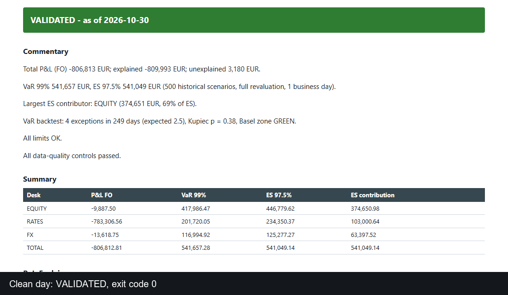

# risk-report-chain

Every morning a market-risk team has to answer one question before it publishes its numbers: can we trust today's data? This chain answers it. It takes the day's CSV extractions, runs 14 controls, computes P&L explain, historical VaR 99% / ES 97.5% with full revaluation, a VaR backtest and limit usage, and writes an Excel report that carries a validation status. Every run is archived and can be replayed to the 9th digit.

**All data is synthetic.** The chain checking itself is not an independent validation (see [methodology](docs/methodologie.md) and [what would change with real data](docs/real-data.md)).



**See it without installing anything:** [clean day](docs/demo/ok.html) · [day with defects](docs/demo/bad.html) · [post-mortem of the bad day](docs/postmortem-example.md). The Excel files are next to them in `docs/demo/`.

## The morning note
The workbook opens on sentences built from the numbers (no language model), for example:

> Total P&L (FO) -716,813 EUR; explained -843,545 EUR; unexplained 126,732 EUR.
> VaR 99% 541,728 EUR, ES 97.5% 541,093 EUR (500 historical scenarios, full revaluation, 1 business day).
> VaR backtest: 4 exceptions in 249 days (expected 2.5), Kupiec p = 0.38, Basel zone GREEN.
> Controls failed: C03 (1), C06 (1), C12 (1).

The banner above it is green (`VALIDATED`), orange (`WITH_RESERVATIONS`) or red (`NOT_VALIDATED`, "do not circulate"). A red day still produces the workbook. Limit breaches and backtest results are results, not data-quality failures: they never change the status.

## What it does
1. Ingests 8 CSV extractions (strict schemas, mixed CSV dialects) for 3 desks and about 52 positions.
2. Runs controls C01-C11 on the inputs, then computes hypothetical P&L, the explain by factor, VaR/ES, the backtest and limit usage.
3. Runs C12-C13 on the P&L explain, writes an 8-sheet workbook, then re-reads it (C14) to check it matches the computed numbers.
4. Sets a status and an exit code: `VALIDATED` 0, `WITH_RESERVATIONS` 1, `NOT_VALIDATED` 2, `CRASH` 3.
5. Archives inputs, outputs, a SHA-256 manifest and a JSON Lines journal; `rerun` replays a run and compares every number at 1e-9. The controls are mapped to [BCBS 239 principles](docs/bcbs239.md).

## Quick start
```bash
pip install -e ".[dev]"
python -m riskreport.cli showcase          # clean day + defective day + replay + HTML views (or: make demo)
python -m riskreport.cli generate-demo --date 2026-10-30
python -m riskreport.cli run --date 2026-10-30
python -m riskreport.cli rerun runs/2026-10-30
```
Inject defects with `generate-demo --defects defects/demo.toml`. A run takes about 10 s on a laptop. `scheduler/install_task.ps1` registers a weekday 07:30 Windows task.

## VaR backtest
Hypothetical backtest with the book held fixed: each of the 249 days after the first 500-scenario window is compared with the VaR computed on the 500 changes before it. The workbook gives the exceptions, Kupiec's proportion-of-failures test and the Basel traffic light (1996 amendment, 99% over 250 days: green up to 4, yellow 5-9, red 10 or more). On the synthetic data the VaR is sometimes too prudent (0 exceptions in 249 days gives Kupiec p = 0.025 for seeds 1 to 3), which is a property of the simulator, not of a real book.

## Benchmark with known truth
For each seed, one clean day and one day per injected defect. Detection = the expected status or worse; false alarm = clean day not `VALIDATED`. Wilson 95% intervals. Two disjoint sets of 200 seeds; the second was run after the first, as a fresh test.

| Case | Seeds 1-200 | Seeds 201-400 (fresh) |
|------|------------|-----------------------|
| 7 data defects (missing / stale price, duplicate, quantity break, 9-sigma jump, missing FX, P&L gap) | 200/200 each (98.1-100%) | 200/200 each (98.1-100%) |
| Limit breach (VaR, DV01) reported without changing status | 197/200 (95.7-99.5%) | 193/200 (93.0-98.3%) |
| **False alarms on clean days** | **3/200 (0.5-4.3%)** | **7/200 (1.7-7.0%)** |

The missed limit cases are exactly the false-alarm seeds in both sets: on those days the status is not `VALIDATED`, so the breach case does not meet the "status stays VALIDATED" rule. Pooled, 10 clean days in 400 raise an alert (2.5%), about one false alert every 40 business days. Causes: all 3 on seeds 1-200 are C07 (jump above 6 EWMA volatilities); on seeds 201-400, 4 are C07 and 3 are C12/C13 (P&L explain above the 5% / 10,000 EUR threshold on days with large moves, where cross terms are not explained). None of these false alarms is blocking.

**Why I did not raise the C07 threshold.** On 100 further clean seeds, 6 volatilities gives 0 false alarms, while the injected 9-sigma jump is missed 1 time in 100 at a threshold of 7, 7 in 100 at 8, 25 in 100 at 9 (`bench/c07_calibration.json`). A higher threshold would trade a few alerts for missed data defects. I left the thresholds unchanged and did not tune the explain thresholds on the fresh seeds, because that would make the second set stop being a test.

Limits of the benchmark: it injects only the defects the controls were designed for, so detection rates are an upper bound for unseen defects. Run it with `python -m bench.benchmark 200 out.json 201`.

## Layout
`src/riskreport` (ingest, controls, valuation, pnl, risk, report, htmlview, pipeline, runlog, cli) · `synth` (synthetic market and defects) · `bench` · `scheduler` · `docs` · `tests`.

MIT licence.
